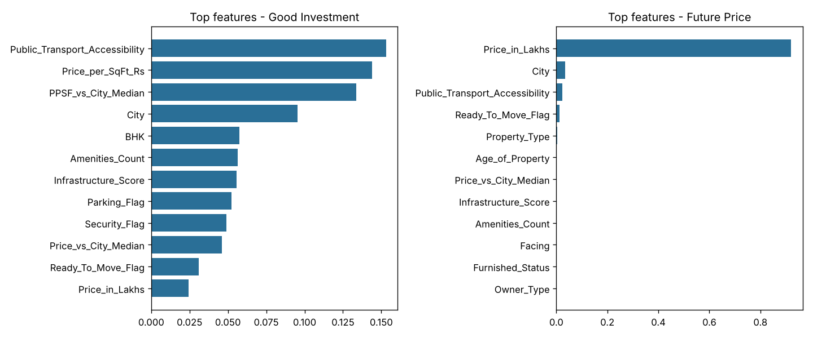

# Real Estate Investment Advisor

### Find out if an Indian residential property is a good investment, and what it could be worth in 5 years

[](https://real-estate-investment-ad.streamlit.app/)

**Live app:** https://real-estate-investment-ad.streamlit.app/

You describe a property: city, size, price, BHK, amenities, transport access and so on. The app returns:

1. **An investment verdict:** *Good Investment* or *Not Recommended*, with the model's confidence (classification)
2. **A 5-year price forecast:** the estimated value in 2030, plus the implied annual growth (CAGR) (regression)

Built with **Python, Pandas, Scikit-learn, XGBoost, MLflow, Plotly and Streamlit**. Trained on **250,000 listings across 42 cities in 20 Indian states**.

---

## Highlights

- **99.6% accuracy** on the investment classifier (ROC-AUC 0.9999)
- **R² 0.998** on the 5-year price forecast
- **6 models compared** (Logistic/Linear Regression, Random Forest, XGBoost). Every run is tracked in **MLflow**, and the best models are registered in the MLflow Model Registry
- **A 5-page interactive app** with a custom UI: predictor, property explorer, India market map and model performance dashboard

---

## App pages

| Page | What it does |
|---|---|
| **Overview** | Market KPIs, a short explanation of how both models decide, market snapshot |
| **Investment Predictor** | Property form → valuation report: verdict, confidence, 2030 value, CAGR, price-path chart, probability gauge, 10-factor checklist |
| **Property Explorer** | Filter by state, city, type, BHK, price, size, availability and transport; download results as CSV |
| **Market Insights** | India city map (switchable metric), heatmaps, growth and trend charts, city table |
| **Model Performance** | Metrics, confusion matrix, actual-vs-predicted plot, feature importance, MLflow details |

---

## Results (test set: 50,000 listings)

| Task | Best model | Metrics |
|---|---|---|
| Good Investment? | XGBoost Classifier | Accuracy **0.996** · F1 **0.996** · ROC-AUC **0.9999** |
| Price after 5 years | XGBoost Regressor | RMSE **₹10.4 L** · MAE **₹7.3 L** · R² **0.998** |

<p align="center">
  
</p>

The strongest drivers of the investment verdict are **public transport access**, **price per sq ft** and **price per sq ft relative to the city median**.

---

## Approach

| Step | What was done |
|---|---|
| **Cleaning** | Checked for nulls and duplicates (none found). Fixed 116,304 rows where `Floor_No > Total_Floors`. Rebuilt price/sq ft in ₹. IQR-capped 19,723 price/sq ft outliers |
| **Feature engineering** | Amenity flags and count, Infrastructure Score, School Density Score, City Tier (1/2/3), price and price/sq ft vs city median |
| **Regression target** | `Future Price = Price × (1 + r)^5`. The rate `r` starts at an 8% base and is adjusted for city tier, transport, infrastructure, construction stage, property type, age and amenities, plus market noise |
| **Classification target** | Multi-factor Investment Score (0–10). A score ≥ 5.5 counts as a Good Investment (54.8% of listings) |
| **Modelling** | 80/20 stratified split. Preprocessing pipeline (scaling + one-hot encoding) with 3 classifiers and 3 regressors |
| **Tracking** | MLflow logs parameters, metrics, plots and models. Champion models are registered under the alias `champion` |
| **Deployment** | Streamlit Community Cloud |

---

## Project structure

```
Real Estate Investment Advisor/
├── app.py                         # Streamlit app (5 pages, custom UI)
├── Real Estate EDA.ipynb          # EDA notebook (25 charts)
├── requirements.txt
├── .streamlit/config.toml         # app theme
├── data/
│   ├── raw/india_housing_prices.csv        # original dataset
│   └── processed/
│       ├── cleaned_housing_data.csv        # cleaned + engineered features + targets
│       └── city_reference_stats.csv        # city medians (market benchmark)
├── src/
│   ├── config.py                  # paths, constants, feature lists
│   ├── data_preprocessing.py      # cleaning, feature engineering, targets
│   ├── eda.py                     # script version of the EDA
│   ├── model_utils.py             # split, pipeline, metric helpers
│   ├── train_models.py            # trains 6 models, logs to MLflow, registers the best
│   └── evaluate.py                # evaluation report + plots
├── models/                        # champion models (.joblib) + metadata
└── reports/
    ├── model_metrics.json         # metrics for all 6 models
    ├── evaluation_report.txt
    └── figures/                   # EDA + evaluation charts
```

---

## Run locally

**Requirement:** Python 3.11 – 3.13

```bash
# 1. Clone the repo
git clone https://github.com/<your-username>/<repo-name>.git
cd <repo-name>

# 2. Create and activate a virtual environment
python -m venv .venv
.venv\Scripts\activate          # Windows
source .venv/bin/activate       # Mac / Linux

# 3. Install dependencies
pip install -r requirements.txt

# 4. Launch the app
streamlit run app.py
```

The app opens at **http://localhost:8501**. Cleaned data and trained models are already in the repo, so no training is needed.

### Rebuild the pipeline (optional)

```bash
pip install mlflow matplotlib seaborn          # only needed for training / EDA
python src/data_preprocessing.py               # ~10 sec  → data/processed/
python src/train_models.py                     # ~3-5 min → models/, mlflow.db
python src/evaluate.py                         # ~20 sec  → reports/
mlflow ui --backend-store-uri sqlite:///mlflow.db   # open http://127.0.0.1:5000
```

---

## Limitations

- The dataset has no historical sale prices, crime rates or RERA data, so both targets are **rule-based** (as suggested in the project brief). The very high scores reflect how well the models learn those rules, not how well they predict real market outcomes.
- The app is for learning and demonstration only. It is **not financial advice**.

---
